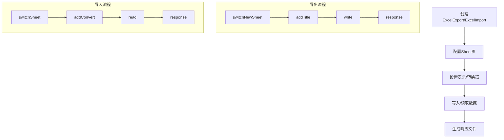

# Excel Utils Boot Starter

[](https://mvnrepository.com/artifact/cn.creekmoon/excel-utils-boot-starter)
[](http://www.apache.org/licenses/LICENSE-2.0.html)

一个基于 EasyExcel 的优雅易用的 Excel 导入导出工具，专为 Spring Boot 应用设计。

## 设计理念

- **易于使用** - 链式调用，三步完成导入导出
- **符合直觉** - API 设计贴近自然语言
- **降低心智负担** - 无需复杂配置，开箱即用
- **功能强大** - 支持多级表头、多 Sheet 页、样式设置、数据验证

## 快速开始

### 1. 引入依赖

```xml
<dependency>
    <groupId>cn.creekmoon</groupId>
    <artifactId>excel-utils-boot-starter</artifactId>
    <version>3.0.0</version>
</dependency>
```

> ⚠️ 从 2.0.0 版本开始，基于 Spring Boot 3.0 (JDK 17) 开发

### 2. 大版本升级说明（v2.3.1+）

**Breaking Changes：**

从 v2.3.1 开始，导入功能进行了架构升级，以更好地支持 API/JSON 场景：

1. **移除** `TitleReader.rowIndex2msg`  
   - 替代方案：使用 `ImportReport` 获取结构化导入结果
   - 影响：直接访问 `reader.rowIndex2msg` 的代码需要迁移到 `reader.getReport()`

2. **Excel 回写行为变化**  
   - 旧版：结果列会为每行写入"导入成功!"或失败原因
   - 新版：结果列**默认只写失败原因**，成功行留空（更节省内存，适合大文件）

3. **新增能力**  
   - `readWithReport()` - 返回结构化 `ImportReport`，可直接序列化为 JSON

4. **行级错误一次报全**  
   - 旧版：一行内第一个字段失败就停止该行转换，用户改完再传才发现下一个错
   - 新版：同一行内所有失败字段一次性收集，`rowErrors` 每个失败字段一条明细（`field` 标明列名），回写 Excel 时合并到同一格

**迁移示例：**

```java
// 旧版（已废弃）
reader.rowIndex2msg.get(rowIndex);  // ❌

// 新版
ImportReport report = reader.getReport();
report.getRowErrors();  // ✅ 获取行级错误
report.getGlobalErrors();  // ✅ 获取导入全局错误
```

详见后续章节：**导入场景 - 场景七：直接返回 JSON 结果（无需 response）**

### 3. 启用工具类

在 Spring Boot 启动类上添加注解：

```java
@EnableExcelUtils
@SpringBootApplication
public class Application {
    public static void main(String[] args) {
        SpringApplication.run(Application.class, args);
    }
}
```

## 导出场景

### 场景一：基础数据导出

最常见的需求：将用户列表导出为 Excel 文件

```java
@GetMapping("/export/users")
public void exportUsers(HttpServletResponse response) {
    // 准备数据
    List<User> users = userService.getAllUsers();
    
    // 三步完成导出
    ExcelExport.create()
        .switchNewSheet(User.class)
        .addTitle("用户名", User::getUsername)
        .addTitle("姓名", User::getFullName)
        .addTitle("邮箱", User::getEmail)
        .addTitle("注册时间", User::getCreateTime)
        .write(users)
        .response(response);
}
```

**生成效果：**
```
| 用户名    | 姓名     | 邮箱              | 注册时间          |
|----------|----------|------------------|------------------|
| zhangsan | 张三     | zhang@email.com  | 2024-01-01 10:00 |
| lisi     | 李四     | li@email.com     | 2024-01-02 14:30 |
```

### 场景二：多级表头导出

业务中经常需要对数据进行分类展示：

```java
@GetMapping("/export/sales")
public void exportSalesReport(HttpServletResponse response) {
    List<SalesData> salesData = salesService.getMonthlySales();
    
    ExcelExport.create()
        .switchNewSheet(SalesData.class)
        .addTitle("基本信息::销售员", SalesData::getSalesName)
        .addTitle("基本信息::所属部门", SalesData::getDepartment)
        .addTitle("业绩数据::本月销售额", SalesData::getCurrentAmount)
        .addTitle("业绩数据::累计销售额", SalesData::getTotalAmount)
        .addTitle("排名", SalesData::getRank)
        .write(salesData)
        .response(response);
}
```

**生成效果：**
```
|        基本信息        |        业绩数据        |      |
| 销售员   | 所属部门    | 本月销售额 | 累计销售额 | 排名  |
|---------|------------|-----------|-----------|------|
| 张三     | 华东区      | 50000     | 300000    | 1    |
| 李四     | 华南区      | 45000     | 280000    | 2    |
```

### 场景三：多工作表导出

一个文件包含多个相关数据表：

```java
@GetMapping("/export/comprehensive")
public void exportComprehensiveReport(HttpServletResponse response) {
    List<Student> students = studentService.getAllStudents();
    List<Teacher> teachers = teacherService.getAllTeachers();
    
    ExcelExport excelExport = ExcelExport.create();
    
    // 学生信息表
    excelExport.switchNewSheet(Student.class)
        .addTitle("学号", Student::getStudentNo)
        .addTitle("姓名", Student::getName)
        .addTitle("年龄", Student::getAge)
        .addTitle("专业", Student::getMajor)
        .write(students);
    
    // 教师信息表  
    excelExport.switchNewSheet(Teacher.class)
        .addTitle("工号", Teacher::getTeacherNo)
        .addTitle("姓名", Teacher::getName)
        .addTitle("学科", Teacher::getSubject)
        .addTitle("职称", Teacher::getTitle)
        .write(teachers);
    
    excelExport.response(response);
}
```

### 场景四：带样式的数据导出

根据业务规则突出显示重要数据：

```java
@GetMapping("/export/financial")
public void exportFinancialReport(HttpServletResponse response) {
    List<FinancialRecord> records = financialService.getMonthlyRecords();
    
    ExcelExport.create()
        .switchNewSheet(FinancialRecord.class)
        .addTitle("项目名称", FinancialRecord::getProjectName)
        
        // 盈利项目显示绿色
        .addTitle("收入金额", FinancialRecord::getIncome, 
                  ExcelCellStyle.LIGHT_GREEN, 
                  record -> record.getIncome() > 0)
        
        // 亏损项目显示橙色
        .addTitle("支出金额", FinancialRecord::getExpense,
                  ExcelCellStyle.LIGHT_ORANGE, 
                  record -> record.getExpense() > record.getIncome())
        
        // 多条件样式：根据净利润设置不同颜色
        .addTitle("净利润", FinancialRecord::getNetProfit,
                  ConditionCellStyle.of(LIGHT_GREEN, r -> r.getNetProfit() > 10000),
                  ConditionCellStyle.of(PALE_BLUE, r -> r.getNetProfit() > 0),
                  ConditionCellStyle.of(LIGHT_ORANGE, r -> r.getNetProfit() <= 0))
        
        .write(records)
        .response(response);
}
```

## 导入场景

### 场景一：标准数据导入

最常见的需求：从 Excel 文件导入用户数据

```java
@PostMapping("/import/users")
public void importUsers(MultipartFile file, HttpServletResponse response) {
    ExcelImport.create(file)
        .switchSheet(0, User::new)
        .addConvert("用户名", User::setUsername)
        .addConvert("姓名", User::setFullName)  
        .addConvert("年龄", IntegerConverter::parse, User::setAge)
        .addConvert("邮箱", User::setEmail)
        .addConvert("注册时间", DateConverter::parse, User::setCreateTime)
        .read(user -> {
            // 处理每一行数据
            userService.saveUser(user);
            log.info("导入用户: {}", user.getUsername());
        })
        .response(response);
}
```

### 场景二：数据验证与错误处理

实际业务中需要对导入数据进行验证：

```java
@PostMapping("/import/products")
public void importProducts(MultipartFile file, HttpServletResponse response) {
    ExcelImport.create(file)
        .switchSheet(0, Product::new)
        .addConvert("产品编码", Product::setProductCode)
        .addConvert("产品名称", Product::setProductName)
        .addConvert("价格", BigDecimalConverter::parse, Product::setPrice)
        .addConvert("库存数量", IntegerConverter::parse, Product::setStock)
        .read(product -> {
            try {
                // 业务验证
                if (productService.existsByCode(product.getProductCode())) {
                    throw new BusinessException("产品编码已存在");
                }
                if (product.getPrice().compareTo(BigDecimal.ZERO) <= 0) {
                    throw new BusinessException("价格必须大于0");
                }
                
                productService.saveProduct(product);
            } catch (Exception e) {
                log.error("导入产品失败: {}", e.getMessage());
                throw e; // 异常会被自动记录到导入结果中
            }
        })
        .response(response);
}
```

### 场景三：指定单元格读取

有时需要从固定位置读取特定数据：

```java
@PostMapping("/import/config")
public void importSystemConfig(MultipartFile file, HttpServletResponse response) {
    ExcelImport.create(file)
        .switchSheetAndUseCellReader(0, SystemConfig::new)
        .addConvert("B1", SystemConfig::setSystemName)      // B1 单元格
        .addConvert("D1", SystemConfig::setVersion)         // D1 单元格  
        .addConvert(2, 3, IntegerConverter::parse, SystemConfig::setMaxUsers) // 第3行第4列
        .read(config -> {
            systemConfigService.updateConfig(config);
        })
        .response(response);
}
```

### 场景四：导入结果验证与处理

在实际业务中，我们经常需要获取导入结果，进行后续的验证和处理：

业务校验直接在消费函数里抛异常，框架会把该行记为失败并带上原因；读完从 `getReport()` 拿统计。

```java
@PostMapping("/import/users-with-validation")
public void importUsersWithValidation(MultipartFile file, HttpServletResponse response) {
    ExcelImport excelImport = ExcelImport.create(file);
    
    TitleReader<User> reader = excelImport.switchSheet(0, User::new)
        .addConvert("用户名", User::setUsername)
        .addConvert("姓名", User::setFullName)
        .addConvert("年龄", IntegerConverter::parse, User::setAge)
        .addConvert("邮箱", User::setEmail)
        .read(user -> {
            // 抛出 CheckedExcelException：只标记当前行失败，后续行继续读
            if (userService.existsByUsername(user.getUsername())) {
                throw new CheckedExcelException("用户名已存在");
            }
            if (!isValidEmail(user.getEmail())) {
                throw new CheckedExcelException("邮箱格式不正确");
            }
            userService.saveUser(user);
        });
    
    ImportReport report = reader.getReport();
    log.info("导入完成：总计 {} 条，成功 {} 条，失败 {} 条",
             report.getTotalRows(), report.getSuccessRows(), report.getErrorRows());
    
    // 生成带有验证结果的Excel文件
    excelImport.response(response);
}
```

### 场景五：分批处理与进度反馈

对于大数据量导入，可以使用consume方法进行分批处理：

```java
@PostMapping("/import/bulk-products")
public void importBulkProducts(MultipartFile file, HttpServletResponse response) {
    ExcelImport excelImport = ExcelImport.create(file);
    
    AtomicInteger processedCount = new AtomicInteger(0);
    AtomicInteger successCount = new AtomicInteger(0);
    
    TitleReader<Product> reader = excelImport.switchSheet(0, Product::new)
        .addConvert("产品编码", Product::setProductCode)
        .addConvert("产品名称", Product::setProductName)
        .addConvert("价格", BigDecimalConverter::parse, Product::setPrice)
        .read((rowIndex, product) -> {
            productService.saveProduct(product);
            successCount.incrementAndGet();
            
            // 进度反馈（每100条记录输出一次）
            int processed = processedCount.incrementAndGet();
            if (processed % 100 == 0) {
                log.info("已处理 {} 条记录，成功 {} 条", processed, successCount.get());
            }
        });
    
    ImportReport report = reader.getReport();
    log.info("导入完成：总计 {} 条，成功 {} 条，失败 {} 条", 
             report.getTotalRows(), report.getSuccessRows(), report.getErrorRows());
    
    excelImport.response(response);
}
```

### 场景六：多工作表导入

从一个文件的多个工作表导入不同类型的数据：

```java
@PostMapping("/import/school-data")
public void importSchoolData(MultipartFile file, HttpServletResponse response) {
    ExcelImport excelImport = ExcelImport.create(file);
    
    // 导入学生数据（第一个工作表）
    ImportReport studentReport = excelImport.switchSheet(0, Student::new)
        .addConvert("学号", Student::setStudentNo)
        .addConvert("姓名", Student::setName)
        .addConvert("年龄", IntegerConverter::parse, Student::setAge)
        .read(student -> studentService.saveStudent(student))
        .getReport();
    
    // 导入教师数据（第二个工作表）
    ImportReport teacherReport = excelImport.switchSheet(1, Teacher::new)
        .addConvert("工号", Teacher::setTeacherNo)
        .addConvert("姓名", Teacher::setName)
        .addConvert("学科", Teacher::setSubject)
        .read(teacher -> teacherService.saveTeacher(teacher))
        .getReport();
    
    // 输出导入摘要
    log.info("学生导入：成功 {} 条，失败 {} 条", 
             studentReport.getSuccessRows(), studentReport.getErrorRows());
    log.info("教师导入：成功 {} 条，失败 {} 条", 
             teacherReport.getSuccessRows(), teacherReport.getErrorRows());
    
    excelImport.response(response);
}
```

### 场景七：直接返回 JSON 结果（无需 response）

**v2.3.1+ 新特性**：很多 API 场景只需要返回导入结果的 JSON，不需要生成 Excel 回写文件。

```java
@PostMapping("/api/import/users")
public ResponseEntity<ImportReport> importUsersApi(@RequestParam("file") MultipartFile file) {
    ExcelImport excelImport = ExcelImport.create(file);
    
    // 无需任何配置，直接获取结构化报告
    ImportReport report = excelImport.switchSheet(0, User::new)
        .addConvert("用户名", User::setUsername)
        .addConvert("邮箱", User::setEmail)
        .addConvert("年龄", IntegerConverter::parse, User::setAge)
        .readWithReport();
    
    // 报告会自动序列化为 JSON 返回给前端
    return ResponseEntity.ok(report);
}
```

> `readWithReport()` 只统计不消费数据。如果需要边读边处理业务，用 `read(consumer)` 后再取 `getReport()`。

**返回的 JSON 结构示例：**

```json
{
  "taskId": "a1b2c3d4-e5f6-7890",
  "sheetName": "Sheet1",
  "totalRows": 150,
  "successRows": 145,
  "errorRows": 5,
  "globalErrors": [],
  "rowErrors": [
    {
      "rowIndex": 23,
      "message": "[失败!]字段[年龄]解析失败！不支持的数据格式!",
      "field": "年龄"
    },
    {
      "rowIndex": 23,
      "message": "[失败!]字段[邮箱]为必填项!",
      "field": "邮箱"
    }
  ]
}
```

关于 `rowErrors` 的两点约定：

- **条数不等于 `errorRows`**。同一行有几个字段失败就有几条明细，上例第 23 行两个字段失败，只算 1 个错误行。
- **`field` 可能为 null**。字段转换类错误会带上列名；`read(consumer)` 或 `addConvertPostProcessor` 里抛出的业务校验错误无法定位到具体列，`field` 为 null。

`ImportReport` 给出的是完整事实，不做截断。如果错误行很多、前端不需要全量展示，由调用方自行裁剪：

```java
ImportReport report = reader.readWithReport();
if (report.getRowErrors().size() > 100) {
    report.setRowErrors(report.getRowErrors().subList(0, 100));
}
return ResponseEntity.ok(report);
```

**模板不匹配会立即停止：**

表头对不上属于文件级失败，继续逐行扫描只会重复同一个原因。此时读取立刻中止，只在 `globalErrors` 记一条 `TEMPLATE_MISMATCH`，行级统计全部为 0。

```java
ImportReport report = excelImport.switchSheet(0, User::new)
    .addConvert("用户名", User::setUsername)
    .addConvert("不存在的列", User::setEmail)  // 模板不匹配
    .readWithReport();

// 返回的 JSON
{
  "totalRows": 0,
  "successRows": 0,
  "errorRows": 0,
  "globalErrors": ["TEMPLATE_MISMATCH"],
  "rowErrors": []
}
```

**一次读取，JSON 报告与 Excel 回写都能拿到：**

同一次读取的结果同时供给两个出口，不需要读第二遍，也不需要任何配置开关。

```java
ExcelImport excelImport = ExcelImport.create(file);
ImportReport report = excelImport.switchSheet(0, User::new)
    .addConvert("用户名", User::setUsername)
    .addConvert("邮箱", User::setEmail)
    .readWithReport();

log.info("总计 {} 条，失败 {} 条", report.getTotalRows(), report.getErrorRows());

// 需要让用户下载带错误标记的文件时，直接 response
if (report.getErrorRows() > 0) {
    excelImport.response(response);
}
```

## 高级特性

### 样式配置

#### 内置样式

工具提供三种预定义样式：

```java
ExcelCellStyle.LIGHT_ORANGE  // 浅橙色背景
ExcelCellStyle.PALE_BLUE     // 浅蓝色背景  
ExcelCellStyle.LIGHT_GREEN   // 浅绿色背景
```

#### 自定义样式

```java
// 创建自定义样式
ExcelCellStyle customStyle = new ExcelCellStyle((workbook, style) -> {
    style.setFillForegroundColor(IndexedColors.YELLOW.getIndex());
    style.setFillPattern(FillPatternType.SOLID_FOREGROUND);
    // 设置数字格式
    style.setDataFormat(workbook.createDataFormat().getFormat("#,##0.00"));
});

// 应用样式
.addTitle("金额", Order::getAmount, customStyle, order -> order.getAmount() > 1000)
```

### 高级配置

#### 启用注解参数说明

```java
@EnableExcelUtils(
    customExceptions = {BusinessException.class},  // 自定义业务异常
    importMaxParallel = 4,                        // 最大导入并发数
    tempFileLifeMinutes = 5                       // 临时文件保留时间（分钟）
)
```

#### 数据转换器

系统提供多种内置转换器：

- `StringConverter` - 字符串转换（默认）
- `IntegerConverter` - 整数转换  
- `BigDecimalConverter` - 高精度数字转换
- `DateConverter` - 日期转换
- `LocalDateTimeConverter` - 本地日期时间转换

### 导入结果处理

#### 三种读取方式

`TitleReader` 配置完列映射后有三个读取入口，读完都可以通过 `getReport()` 拿到统计：

```java
// 1. 边读边处理（推荐）：消费函数抛异常即标记该行失败
reader.read(user -> userService.save(user));

// 2. 需要行号时用双参版本，rowIndex 从 0 开始（表头行也计入）
reader.read((rowIndex, user) -> log.info("第{}行: {}", rowIndex + 1, user));

// 3. 只要统计、不消费数据
ImportReport report = reader.readWithReport();
```

```java
// 读完取全量成功数据（内部会触发一次读取）
List<User> users = reader.getAll();

// 读完取统计报告
ImportReport report = reader.getReport();
```

#### 业务校验：抛异常 vs 手动判断

消费函数里抛异常，框架会自动捕获、累加错误计数、记录行号和原因。**异常类型决定后续行是否继续读**：

```java
reader.read(user -> {
    // CheckedExcelException 及 @EnableExcelUtils(customExceptions=...) 注册的异常
    // → 只标记当前行失败，后续行继续读
    if (user.getAge() < 18) {
        throw new CheckedExcelException("年龄不能小于18岁");
    }
    if (userService.existsByUsername(user.getUsername())) {
        throw new CheckedExcelException("用户名已存在");
    }
    
    // 未注册的异常（如 NPE、数据库连接失败）
    // → 视为非预期故障，整表读取立即中断并记 IMPORT_INTERRUPTED
    userService.save(user);
});
```

需要批量操作（比如攒够 500 条再落库）时，用 `getAll()` 拿全量数据自行处理。这种方式下框架只负责解析阶段的错误，业务阶段的成败需要你自己记录。

```java
List<User> users = reader.getAll();
ImportReport report = reader.getReport();  // 解析阶段的统计仍然可用

Lists.partition(users, 500).forEach(batch -> userService.saveBatch(batch));
```

**两种方式的取舍：**

| 特性 | `read(consumer)` | `getAll()` 后自行处理 |
|------|------------------|----------------------|
| 异常处理 | 自动捕获并计入报告 | 需要自己 try-catch |
| 错误计数与行号 | 自动累加、自动带行号 | 无法关联回行号 |
| 回写 Excel 错误列 | 自动 | 不支持 |
| 内存占用 | 逐行处理，不驻留 | 全量驻留 |
| 适用场景 | 逐条业务处理 | 需要批量操作 |

#### 导入结果文件

调用 `response()` 方法后，系统会自动生成一个包含导入结果的Excel文件：

- 在原始数据右侧添加"导入结果"列
- **v2.3.1+ 变化**：默认只显示失败行的原因，成功行留空（节省内存，适合大文件）
- 失败的数据会保留原始内容，便于用户修改后重新导入

#### 导入全局错误说明（v2.3.1+）

| 全局错误枚举 | 含义 | 何时出现 |
|---------|------|---------|
| `TEMPLATE_MISMATCH` | 模板不匹配 | Excel 标题列与配置的列不一致 |
| `IMPORT_INTERRUPTED` | 导入中断 | 非预期异常导致读取中断 |

**导入结果列内容示例：**

```
| 用户名  | 邮箱         | 年龄 | 导入结果                                                          |
|--------|-------------|------|-----------------------------------------------------------------|
| zhang  | z@email.com | 25   |                                                                 | ← 成功行留空
| li     | invalid     | abc  | [失败!]字段[年龄]解析失败！不支持的数据格式!                          |
| wang   |             | abc  | [失败!]字段[邮箱]为必填项!；[失败!]字段[年龄]解析失败！不支持的数据格式! | ← 一行多错合并到一格
```

## 最佳实践

### 1. 错误处理

```java
// 推荐：使用自定义异常进行业务验证
@EnableExcelUtils(customExceptions = {BusinessException.class})

// 在导入处理中
.read(data -> {
    if (invalidData(data)) {
        throw new BusinessException("数据验证失败：" + data.toString());
    }
    saveData(data);
});
```

## 技术架构

### 核心执行流程




