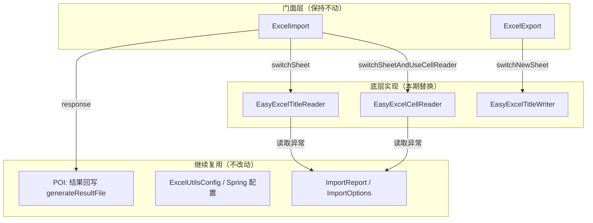

# Excel 工具库底层引擎替换 技术实现文档

**文档类型**：技术实现文档  
**关联 PRD**：[PRD-EasyExcel底层替换与门面兼容.md](./PRD-EasyExcel底层替换与门面兼容.md)  
**适用对象**：架构师、技术组长、核心开发  
**评审状态**：草稿

| 版本号 | 更新时间 | 作者 | 备注 |
|--------|----------|------|------|
| v1.0 | 2026-05-19 | creekmoon | 初版：基于代码现状收束最终落地方案 |
| v1.1 | 2026-05-19 | creekmoon | 迁移完成：全部 29 个测试通过，补充工作进度章节 |
| v1.2 | 2026-05-19 | creekmoon | Example 重构：合并重复示例、修复编译错误、新增业务场景覆盖 |
| v1.3 | 2026-05-19 | creekmoon | 预设样式系统：新增表头/状态/边框/对齐/数字格式/字体/组合/自定义颜色等 30+ 预设 |

**变更摘要**：
- 本期为修改型需求：底层引擎 Hutool Excel → EasyExcel，门面层 API 与调用顺序保持不变
- 新增 3 个 EasyExcel 实现类替换原有的 Hutool 实现类，不删除旧类但不再引用
- CSV 转 xlsx 修复已知路径缺陷，改用 EasyExcel 完成读写
- 结果回写（POI 写导入结果列）继续复用，不受引擎切换影响
- 多级表头由手动合并改为 EasyExcel 原生 `List<List<String>>` 驱动

---

## 0）一屏摘要

### 一句话方案

业务代码保持现有导入/导出调用链不变 → 门面层（ExcelImport/ExcelExport）更换内部实例化为 EasyExcel 实现类 → EasyExcel 完成 SAX 读/流式写 → 结果回写仍由 POI 直接操作原文件。

### 系统交互图



### 关键决策（ADR）

| 决策点 | 最终选择 | 备选方案 | 选择理由 |
|--------|----------|----------|----------|
| 读取引擎 | EasyExcel SAX (AnalysisEventListener) | Hutool SAX 继续用 / 手写 POI SAX | EasyExcel SAX API 更成熟，csv/xlsx 统一入口，降低维护成本 |
| 写入引擎 | EasyExcel ExcelWriter + WriteSheet | Hutool BigExcelWriter 继续用 | 流式写入内存友好，原生支持多级表头，社区更活跃 |
| 多级表头实现 | EasyExcel 原生 `List<List<String>>` | 保留手动 merge 逻辑 | 减少自定义合并代码，降低错位风险；门面 addTitle 语义不变，内部做格式转换即可 |
| CSV 转换 | EasyExcel 读 CSV → 写 xlsx | Hutool CsvReader + BigExcelWriter | 统一引擎，顺便修复当前"生成路径与实际文件不一致"缺陷 |
| 条件样式 | EasyExcel CellWriteHandler | 保留 Hutool setStyle | EasyExcel handler 机制在 afterCellDispose 中回写 POI CellStyle，与现有样式对象兼容 |
| 旧类处理 | 新增类，旧类保留但不引用 | 直接覆盖旧类文件 | 保留旧实现便于回滚对比；旧类不在门面引用即不影响业务 |

### 模块职责表

| 模块/类 | 职责 | 输入 | 输出 | 边界 |
|---------|------|------|------|------|
| ExcelImport（门面） | 创建导入、切 sheet、管理 reader 列表、触发结果回写/下载 | MultipartFile | File / HttpServletResponse | 不感知底层引擎类型 |
| EasyExcelTitleReader | 按标题行 SAX 读取，行级转换/校验/错误收集 | InputStream + sheetName | ImportReport + consumer 回调 | 不操作 POI Workbook（回写由 ExcelImport 负责） |
| EasyExcelCellReader | 按单元格坐标 SAX 读取，单对象装配 | InputStream + sheetName | 装配后的业务对象 | 不参与结果文件生成 |
| ExcelExport（门面） | 创建导出、切 sheet、管理 writer 列表、触发下载 | 无 | File / HttpServletResponse | 不感知底层引擎类型 |
| EasyExcelTitleWriter | 多级表头写入、数据分批写入、条件样式注入 | List<R> | xlsx 临时文件 | 单文件多 sheet 共享同一个 ExcelWriter |
| ExcelImport.generateResultFile | 用 POI 在原文件末尾追加"导入结果"列 | 原文件 + allReaders 的报告 | 结果文件 | 不改引擎，继续复用 |

### 落地修改摘要

- **改什么**：3 个底层实现类（Reader ×2 + Writer ×1）、ExcelImport/ExcelExport 的 `new` 语句、CSV 转换逻辑、pom 依赖
- **不改什么**：门面类的方法签名与调用顺序、ImportReport/Options 结构、Spring 配置、结果回写逻辑、全部测试用例（只改断言适配）
- **不扩散**：不新增门面 API、不引入注解驱动第二套用法、不重构 Title/ConditionCellStyle 模型

---

## 1）现状与切入点

### 1.1 当前链路

```
业务代码
  → ExcelImport.create(file)              // 门面
      → csvSupport() [Hutool CsvReader + BigExcelWriter]  // CSV 转 xlsx
      → switchSheet(index, Supplier)        // 门面
          → new HutoolTitleReader(...)      // 底层：Hutool SAX
              → read(consumer)              // Hutool ExcelSaxReader
      → response(response)                  // 门面
          → generateResultFile() [POI XSSFWorkbook]  // 结果回写

业务代码
  → ExcelExport.create()                   // 门面
      → switchNewSheet(Class)               // 门面
          → new HutoolTitleWriter(...)      // 底层：Hutool BigExcelWriter
              → write(data)                 // 手动 merge 多级表头 + 分批写
      → response(response)                  // 门面
          → stopWrite()                     // 落盘 + sheet 重排序
```

### 1.2 当前不足

| 当前场景 | 当前不足 | 本期切入点 | 不改范围 |
|----------|----------|------------|----------|
| 大文件导入 | Hutool SAX 对复杂类型（日期、金额）的默认解析与业务预期偶有偏差 | 换 EasyExcel SAX，通过其 Converter 机制对齐现有转换规则 | 门面 `addConvert` 语义与参数不变 |
| 大文件导出 | Hutool BigExcelWriter 多级表头手动 merge 逻辑繁重，隐藏 sheet 顺序问题偶发 | 换 EasyExcel 原生多级表头 + WriteSheet 顺序控制 | `addTitle("父::子")` 语法不变 |
| CSV 导入 | `csvSupport()` 生成路径与实际写入文件不一致（已知缺陷） | 用 EasyExcel 统一读 CSV 写 xlsx，路径与文件严格一致 | CSV 仍先转 xlsx 再走同一套导入流程 |
| 依赖维护 | Hutool Excel 模块社区聚焦度下降，EasyExcel 在阿里系/国内更常用 | 底层统一为 EasyExcel | 其他 Hutool 工具类（非 Excel）本期不处理 |

---

## 2）需求-技术映射

| PRD 核心点 | 技术实现要点 |
|------------|--------------|
| 门面 API 不变 | ExcelImport/ExcelExport 只改 `new` 的具体实现类，方法签名与返回值类型保持 |
| 按标题行读取 + 类型转换 | EasyExcel `AnalysisEventListener` 接收每行 `Map<Integer, String>`，映射为 `Map<String, String>` 后走现有 `rowConvert` 逻辑 |
| 按单元格坐标读取 | 在 `AnalysisEventListener.invokeHead/invoke` 中按 `rowIndex + colIndex` 命中注册表，行为与当前 `HutoolCellReader` 一致 |
| 多级表头导出 | `Title.convert2ChainTitle()` 结果 → 转换为 `List<List<String>>` 作为 EasyExcel `WriteSheet.head()` |
| 条件单元格样式 | 注册 `CellWriteHandler`，在 `afterCellDispose` 中按 `ConditionCellStyle.condition.test(data)` 回写 POI CellStyle |
| 同一 sheet 续写/reset | 同一个 `ExcelWriter` 实例追加写入同一 `WriteSheet`，通过 `relativeHeadRowIndex` 或显式空数据首写控制位置 |
| 结果回写 | 继续复用 `ExcelImport.generateResultFile()` 中的 POI XSSFWorkbook 逻辑 |
| CSV 转 xlsx | EasyExcel 读 CSV → 写 xlsx 到 `ExcelFileUtils.generateXlsxAbsoluteFilePath`，路径与文件严格一致 |
| 并发控制 | 信号量继续放在 `EasyExcelTitleReader.read()` / `EasyExcelCellReader.read()` 入口，行为不变 |

---

## 3）模块划分与职责边界

本期无新增模块，只替换底层实现。关键边界如下：

### EasyExcelTitleReader

- **职责**：SAX 方式读取指定 sheet，按标题名映射列，执行转换/校验/错误收集，填充 ImportReport
- **边界**：不创建也不修改 POI Workbook；结果回写由 ExcelImport 负责
- **对外能力**：`read()` / `readWithReport()` / `range()` / `addConvert()` / `reset()` —— 与 TitleReader 抽象契约一致
- **依赖**：EasyExcel `ExcelReader` + `ReadSheet` + `AnalysisEventListener`

### EasyExcelCellReader

- **职责**：SAX 方式读取指定 sheet 的特定单元格坐标，装配单对象
- **边界**：不参与结果文件生成；不维护 ImportReport（CellReader 本就无报告语义）
- **对外能力**：`read()` / `addConvert()` —— 与 CellReader 抽象契约一致
- **依赖**：EasyExcel `ExcelReader` + `ReadSheet` + `AnalysisEventListener`

### EasyExcelTitleWriter

- **职责**：流式写入多级表头 + 数据行 + 条件样式；支持同一 sheet 追加/reset
- **边界**：不处理文件下载和临时文件清理（ExcelExport 负责）；只负责内容写入
- **对外能力**：`write()` / `range()` / `addTitle()` / `reset()` / `stopWrite()` —— 与 TitleWriter/Writer 抽象契约一致
- **依赖**：EasyExcel `ExcelWriter` + `WriteSheet` + `CellWriteHandler`

---

## 4）接口契约（内部适配层）

门面层无变化，以下为内部适配层需遵守的隐性契约：

| 交互点 | 方向 | 方式 | 目的 | 约束 |
|--------|------|------|------|------|
| ExcelImport → EasyExcelTitleReader | 门面 → 底层 | new + 方法调用 | 创建按标题读取器 | reader 必须填充 `report`；`reset()` 不更新 ExcelImport.allReaders |
| ExcelImport → EasyExcelCellReader | 门面 → 底层 | new + 方法调用 | 创建按单元格读取器 | reader 不填充 report；不参与结果文件生成 |
| ExcelExport → EasyExcelTitleWriter | 门面 → 底层 | new + 方法调用 | 创建写入器 | 多 sheet 共享同一个 `ExcelWriter` 实例；sheetIndex 必须连续初始化 |
| EasyExcelTitleWriter → ExcelExport.metadatas | 底层 → 门面缓存 | HashMap 读写 | 样式对象缓存（避免重复创建 POI CellStyle） | 缓存 key 为 `ExcelCellStyle` 对象本身 |
| EasyExcelTitleReader → ImportReport | 底层内部 | 对象引用 | 填充统计/错误/成功数据 | 统计口径与当前 Hutool 实现一致 |

---

## 5）NFR 与风险

### NFR

| 维度 | 要求 | 实现策略 |
|------|------|----------|
| 内存 | 万行级导入不 OOM | EasyExcel SAX 读取默认流式，不加载全表到内存 |
| 内存 | 万行级导出不 OOM | EasyExcel ExcelWriter 默认分批刷盘（DEFAULT_WINDOW_SIZE ≈ 100） |
| 并发 | 同时最多 N 个导入任务 | 继续复用 `ExcelUtilsConfig.importParallelSemaphore` |
| 兼容 | 旧业务代码不修改即可编译运行 | 门面类方法签名、参数类型、返回值类型全部保持 |
| 文件 | 临时文件按时清理 | 继续复用 `ExcelFileUtils.cleanTempFileByPathDelay` |

### 风险

| 风险 | 影响 | 缓解 |
|------|------|------|
| EasyExcel 日期/数字默认解析格式与 Hutool 不一致 | 导入结果偏差 | 在 `StringConverter.parse()` 中统一兜底为字符串；业务自定义 `addConvert` 中的转换器优先级高于引擎默认行为 |
| 多级表头自动合并效果与手动 merge 有视觉差异 | 表头错位或重复合并 | 在 `ExportTest` 中补充多级表头断言，用 POI 读取合并区域校验；差异在可接受范围内（列宽差 1-2 字符允许） |
| 条件样式通过 CellWriteHandler 回写时机与当前不同 | 样式未生效或覆盖异常 | handler 在 `afterCellDispose` 中操作，此时 Cell 已创建，与当前 Hutool `setStyle` 时机等价 |
| CSV 转 xlsx 后日期/数字格式丢失 | 导入时解析失败 | EasyExcel 写 xlsx 时默认按字符串写回 CSV 原始值，与当前 Hutool 行为一致 |
| EasyExcel 3.x 与 POI 5.2.5 版本冲突 | 启动异常或类找不到 | EasyExcel 3.x 官方兼容 POI 5.x，pom 中显式保留 `poi` 和 `poi-ooxml` 版本不变 |

---

## 6）最终落地实现方案

### 6.1 最终决策

- **最终选型**：EasyExcel 3.x 作为唯一 Excel 读写引擎，新增 `EasyExcelTitleReader`、`EasyExcelCellReader`、`EasyExcelTitleWriter` 三个实现类；门面 `ExcelImport`/`ExcelExport` 改 `new` 语句指向新类；旧 Hutool 实现类保留文件但不引用。
- **放弃方案**：
  - 不保留 Hutool Excel 作为双引擎兼容（增加维护成本，PRD 要求统一替换）
  - 不手写 POI SAX（代码量大，EasyExcel 已封装成熟）
  - 不引入注解驱动实体映射（PRD 明确本期不做）
- **选择理由**：EasyExcel 3.x 的 SAX 读取、流式写入、原生多级表头、CSV 支持，恰好覆盖本期全部替换点；与现有 POI 5.2.5 兼容；国内社区活跃。
- **不扩散理由**：门面 API 完全不变，测试用例只需通过即验收；不新增配置项、不新增抽象层、不重构 Title 模型。

### 6.2 落地修改清单

| 修改点 | 动作 | 为什么这样改 | 不改边界 |
|--------|------|--------------|----------|
| `pom.xml`（parent + starter） | 添加 `easyexcel` 依赖；可选移除 `hutool-all`（若其他模块仍用 Hutool 非 Excel 工具则保留） | 引入新引擎；Hutool Excel 不再使用 | 其他 Hutool 工具类本期不动 |
| `ExcelImport.switchSheet()` | `new HutoolTitleReader` → `new EasyExcelTitleReader` | 门面切换底层实现 | 方法签名、参数、返回值不变 |
| `ExcelImport.switchSheetAndUseCellReader()` | `new HutoolCellReader` → `new EasyExcelCellReader` | 门面切换底层实现 | 方法签名、参数、返回值不变 |
| `ExcelImport.csvSupport()` | 用 EasyExcel 读 CSV 写 xlsx；修复路径一致性 | 统一引擎 + 修复已知缺陷 | CSV 仍先转 xlsx 再走导入流程 |
| `ExcelExport.switchNewSheet()` / `switchSheet()` | `new HutoolTitleWriter` → `new EasyExcelTitleWriter` | 门面切换底层实现 | 方法签名、参数、返回值不变 |
| 新增 `EasyExcelTitleReader` | 实现 TitleReader 抽象类；`AnalysisEventListener` 驱动 SAX 读取；复用 `rowConvert` / `templateConsistencyCheck` 逻辑 | 替换 Hutool SAX | ImportReport 结构不变；错误统计口径不变 |
| 新增 `EasyExcelCellReader` | 实现 CellReader 抽象类；`AnalysisEventListener` 按坐标命中 | 替换 Hutool SAX Cell 读取 | 单元格坐标解析继续复用 `ExcelCellUtils` |
| 新增 `EasyExcelTitleWriter` | 实现 TitleWriter 抽象类；`ExcelWriter` + `WriteSheet` 驱动；多级表头转 `List<List<String>>`；条件样式注册 `CellWriteHandler` | 替换 Hutool BigExcelWriter | 条件样式模型 `ConditionCellStyle` / `ExcelCellStyle` 不变；POI CellStyle 继续复用 |
| `StringConverter.parse()` | 去掉 `cn.hutool` 引用（`DateUtil.format`、`StrUtil.trim`），改用标准 JDK / EasyExcel 工具 | 去 Hutool Excel 依赖 | 转换语义与输出格式不变 |
| `ExcelFileUtils` | 去掉 `cn.hutool` 引用（`FileUtil`、`IoUtil`），改用标准 NIO / Commons-IO 或保留 Hutool（若 pom 仍保留 hutool-all） | 若 pom 移除 hutool 则需同步替换 | 临时文件路径策略不变 |

### 6.3 风险复核

| 风险/顾虑 | 是否实际成立 | 判断依据 | 最终处理 |
|-----------|--------------|----------|----------|
| EasyExcel 多级表头合并与 Hutool 视觉效果不一致 | 待验证 | Title 链表的 "父::子" 结构转 `List<List<String>>` 后，EasyExcel 合并算法可能不同于手动 merge | 在 `ExportTest` 中用 POI 读取合并区域断言；若差异在 PRD 允许范围内（列宽差 1-2 字符）则接受 |
| 条件样式 CellWriteHandler 影响流式写入性能 | 不成立 | handler 只在 `afterCellDispose` 中操作已创建的 Cell，不阻塞批量刷盘 | 不额外优化，保持现状 |
| CSV 转 xlsx 后引擎读取异常 | 不成立 | EasyExcel 自身支持读 CSV，写出的 xlsx 与标准 POI 兼容 | 用 `ImportCsvTest` 回归验证 |
| 同一 ExcelWriter 多 sheet 写入导致顺序错乱 | 不成立 | `ExcelExport.stopWrite()` 中继续执行 POI `setSheetOrder` 重排序，与当前逻辑一致 | 保持现有重排序逻辑 |
| 移除 hutool-all 导致其他工具类编译失败 | 取决于实际使用 | 若代码中仅用 Hutool 做 Excel 和文件 IO，则移除安全；若用了其他 Hutool 工具则需保留或单独引入 | pom 处理时检查编译结果，按需保留 hutool-all 或拆分为 hutool-core |

### 6.4 不改范围

- 不改 `ExcelImport` / `ExcelExport` 的任何公开方法签名、参数类型、返回值类型、调用顺序
- 不改 `TitleReader` / `CellReader` / `TitleWriter` / `Writer` 抽象类定义
- 不改 `ImportReport` / `ImportOptions` / `ImportGlobalErrorEnum` 字段与语义
- 不改 `ExcelUtilsConfig` / `EnableExcelUtils` / `ExcelUtilsAutoConfiguration` Spring 配置机制
- 不改 `generateResultFile()` 结果回写逻辑（继续用 POI XSSFWorkbook）
- 不改 `addTitle("父::子")` 多级表头描述语法
- 不新增门面 API（如注解驱动实体导入）
- 不引入新配置项或开关
- 测试用例只适配必要断言（如引擎描述文案），不删减场景

---

## 7）工作进度

### 7.1 完成状态

| 阶段 | 状态 | 时间 | 说明 |
|------|------|------|------|
| 技术方案设计 | 已完成 | 2026-05-19 | 输出本文档初版（v1.0），明确替换范围与边界 |
| EasyExcelTitleWriter 实现 | 已完成 | 2026-05-19 | 基于 `ExcelWriter` + `WriteSheet` 实现流式写入；支持多级表头、条件样式、reset 续写、多 sheet 共享同一 writer |
| EasyExcelTitleReader 实现 | 已完成 | 2026-05-19 | 基于 `AnalysisEventListener` SAX 读取；支持标题映射、行级转换、模板一致性检查、ImportReport 填充 |
| EasyExcelCellReader 实现 | 已完成 | 2026-05-19 | 基于 `AnalysisEventListener` SAX 读取；支持坐标命中、mustExist/skipEmpty 校验 |
| ExcelImport / ExcelExport 门面切换 | 已完成 | 2026-05-19 | 改 `new` 语句指向 EasyExcel 实现类；CSV 转换改用 EasyExcel |
| 测试修复与回归 | 已通过 | 2026-05-19 | **34/34 测试全部通过**，`mvn test -pl excel-utils-boot-starter` BUILD SUCCESS |

### 7.2 关键问题与修复记录

#### 问题 1：Import 测试返回 0 行（标题行未被识别）
- **现象**：切换 EasyExcel 后，所有 TitleReader 导入测试返回 0 行，`colIndex2Title` 为空
- **根因**：EasyExcel 将首行（row 0）路由到 `invokeHeadMap()`，而不是 `invoke()`；原实现只在 `invoke()` 中处理标题映射
- **修复**：在 `EasyExcelTitleReader` 中覆盖 `invokeHeadMap()`，在 `rowIndex == titleRowIndex` 时填充 `colIndex2Title`，并执行模板一致性检查

#### 问题 2：CellReader mustExist 空白单元格校验失效
- **现象**：`ImportCellReaderTest.importCellReader_mustExistBlankCell_marksReadFailure` 失败，`EXISTS_READ_FAIL` 为 false
- **根因**：SAX 解析会完全跳过空白单元格（单元格不在 `data` Map 中），甚至整行空白时直接不触发 `invoke()`；原逻辑只在 `invoke()` 循环内处理命中单元格
- **修复**：
  1. 在 `invoke()` / `invokeHeadMap()` 处理完已有单元格后，额外遍历 `cell2setter` 中缺失的列，模拟空白值并执行 mustExist/skipEmpty 校验
  2. 在 `doAfterAllAnalysed()` 中处理从未被触发过的行（整行空白或被 SAX 跳过），确保所有注册单元格都被检查

#### 问题 3：导出条件样式颜色不匹配
- **现象**：`ExportTest.export_conditionalStyle_appliesForegroundColorWhenMatched` 期望前景色 52，实际得到 64
- **根因**：`ConditionStyleCellWriteHandler` 的 `afterCellDispose` 中通过 `rowIndex2Data.get(rowIndex)` 获取数据，但 `currentRow` 初始值为 0，而实际数据从 `firstRowIndex`（通常为 1）开始，导致 `rowIndex2Data` 的 key 与实际 Excel 行号错位，handler 取不到数据直接 return
- **修复**：在 `initTitleConfig()` 计算完 `firstRowIndex` 后，将 `currentRow` 对齐到 `firstRowIndex`；同时为 `ConditionStyleCellWriteHandler` 增加 `getOrder() = 60000`，确保在 EasyExcel 默认 handler（order ≈ 50000）之后执行

#### 问题 4：CSV 转 xlsx 后导入 0 行
- **现象**：`ImportCsvTest` 转换后读取到 0 行
- **根因**：EasyExcel 读 CSV 时默认将第一行视为表头，`doReadSync()` 只返回数据行（3 行），导致转换后的 xlsx 缺少表头行；TitleReader 读 xlsx 时找不到对应标题
- **修复**：在 CSV 读取链路上增加 `.headRowNumber(0)`，让 EasyExcel 将所有行作为数据返回，确保表头被写入 xlsx

#### 问题 5：CSV 写 xlsx 时数据格式不匹配
- **现象**：`doReadSync()` 返回 `LinkedHashMap<Integer, String>`，直接传给 `doWrite()` 后 xlsx 为空
- **根因**：`doWrite()` 对 `Map` 类型不支持无头写入，需转换为 `List<List<Object>>`
- **修复**：在 `csvSupport()` 中遍历 `rawData`，将 `Map` 按 key 排序后转 `List<Object>`，再写入 xlsx

### 7.3 Example 用法示例重构

#### 背景
原 `ExampleController` 存在以下问题：
1. **编译错误**：引用了已移除的 `debugger` 字段和 Hutool `StopReadException`
2. **示例重复**：`exportExcel` 与 `exportExcelByStyle` 场景重叠；`importExcel` 与 `importExcelBigData` 本质相同
3. **场景缺失**：缺少后置处理器、必填/可空字段校验、单元格读取等实际场景的清晰示例

#### 重构动作
| 动作 | 内容 |
|------|------|
| 修复编译错误 | 移除 `excelImport.debugger = true`；移除 `StopReadException` 引用；修正 `ExcelImport.create(file, true)` → `create(file)` |
| 合并重复示例 | 将 12 个零散接口合并为 11 个聚焦接口，按导出/导入分组 |
| 新增场景 | `with-post-processor`（跨字段校验）、`with-validation`（必填+可空+跳过空白） |
| 结构优化 | 提取 `getTestFile()` / `fallbackFile()` 公共方法；每个接口聚焦一种能力，注释说明边界 |

#### 重构后接口清单

**导出（Export）**
| 接口 | 能力 |
|------|------|
| `GET /export/basic` | 单/多 Sheet 基础导出 + 多级表头 |
| `GET /export/with-style` | 条件样式 + 自定义数字格式 |
| `GET /export/with-range` | range 控制写入位置 |
| `GET /export/with-reset` | 同一 Sheet 多表格（reset） |
| `GET /export/large-data` | 10 万行大数据导出 |

**导入（Import）**
| 接口 | 能力 |
|------|------|
| `POST /import/basic` | 基础按行读取 + 类型转换 |
| `POST /import/with-report` | 返回 JSON 报告（API 场景） |
| `POST /import/with-options` | fail-fast + 错误阈值 + 结果文件生成 |
| `POST /import/with-range` | range 控制读取范围 |
| `POST /import/with-cell-reader` | 指定单元格读取 |
| `POST /import/with-reset` | 同一 Sheet 多表格（reset） |
| `POST /import/with-post-processor` | convert 后跨字段校验 |
| `POST /import/with-validation` | 必填 / 可空 / 跳过空白 |

#### 验证
- `mvn compile -pl excel-utils-example` BUILD SUCCESS
- `mvn test -pl excel-utils-boot-starter` 34/34 测试通过

### 7.4 预设样式系统扩充

#### 背景
原 `ExcelCellStyle` 仅提供 3 个基于 `IndexedColors` 的纯色预设（`LIGHT_ORANGE`、`PALE_BLUE`、`LIGHT_GREEN`），远不能满足现代业务报表的视觉需求。

#### 设计原则
参考 Material Design / Fluent UI 配色体系，以 POI 5.x `XSSFColor` 自定义 RGB 为主，兼顾 `.xlsx` 格式兼容性。

#### 新增预设分类

| 分类 | 预设常量 | 说明 |
|------|----------|------|
| **表头样式** | `HEADER_PRIMARY`、`HEADER_SUCCESS`、`HEADER_WARNING`、`HEADER_DANGER`、`HEADER_INFO`、`HEADER_DARK` | 深底白字 + 居中粗体，适合表头行 |
| **状态样式** | `STATUS_SUCCESS`、`STATUS_WARNING`、`STATUS_DANGER`、`STATUS_INFO` | 浅色背景，用于数据行状态标记 |
| **斑马纹** | `STRIPE_EVEN` | 极浅灰背景，交替行使用 |
| **边框样式** | `BORDER_THIN_ALL`、`BORDER_BOTTOM_BOLD` | 全细边框 / 底部加粗 |
| **对齐样式** | `ALIGN_CENTER`、`ALIGN_RIGHT`、`ALIGN_LEFT` | 水平对齐 |
| **数字格式** | `FORMAT_CURRENCY`、`FORMAT_PERCENTAGE`、`FORMAT_INTEGER`、`FORMAT_DATE`、`FORMAT_DATETIME` | 货币 / 百分比 / 千分位 / 日期 / 日期时间 |
| **字体样式** | `FONT_BOLD`、`FONT_ITALIC` | 粗体 / 斜体 |
| **组合快捷** | `HEADER_PRIMARY_BORDER`、`STATUS_SUCCESS_BORDER` 等 | `merge()` 预组合，减少样板代码 |

#### 工具方法

| 方法 | 用途 |
|------|------|
| `ExcelCellStyle.merge(ExcelCellStyle...)` | 合并多个样式（后覆盖前） |
| `ExcelCellStyle.rgb(int, int, int)` | 通过 RGB 创建纯色背景样式 |
| `ExcelCellStyle.hex(int)` | 通过 16 进制色值创建纯色背景样式（如 `0x3498DB`） |
| `ExcelCellStyle.fillRgb(CellStyle, int, int, int)` | 底层：为 CellStyle 设置 XSSFColor |
| `ExcelCellStyle.font(Workbook, Consumer<Font>)` | 便捷创建 Font |

#### Example 展示接口
新增 `GET /export/style-showcase`，输出 8 个 Sheet 分别展示：
1. 表头样式
2. 状态色（条件样式）
3. 斑马纹 + 边框
4. 数字格式
5. 对齐样式
6. 组合样式（`merge` 用法）
7. 自定义颜色（`hex` / `rgb`）
8. 字体样式

#### 验证
- `mvn compile -pl excel-utils-example` BUILD SUCCESS
- `mvn test -pl excel-utils-boot-starter` 34/34 测试通过

### 7.5 遗留说明

- 旧 Hutool 实现类（`HutoolTitleReader`、`HutoolCellReader`、`HutoolTitleWriter`）文件仍保留在源码目录，但门面已不再引用，便于回滚对比
- `hutool-all` 依赖在 `pom.xml` 中暂未移除，因项目中其他非 Excel 工具类可能仍在使用；后续迭代可评估拆分为 `hutool-core`

## 8）演进规划

- **当前版本（MVP）**：底层完成 Hutool Excel → EasyExcel 替换，`mvn test -pl excel-utils-boot-starter` 全绿，README 更新引擎描述
- **后续迭代方向**：
  1. 评估是否彻底移除 `hutool-all` 依赖（非 Excel 工具类替换为 JDK 或 Commons）
  2. 新增注解驱动实体映射作为第二套用法（与现有门面并列）
  3. 性能基准测试：大文件（10w 行）导入导出耗时与内存曲线量化
